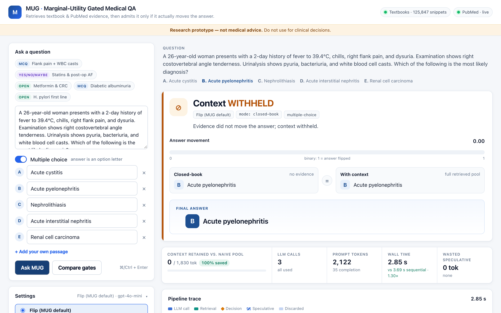

# MUG-Serve: retrieval-gated medical QA

Retrieved passages can pull an LLM away from a correct answer. **MUG** (marginal-utility gating) uses evidence only
when it changes the model's answer, and optionally only when a verifier finds a quote in it that supports the new
answer. This repo serves MUG as a medical Q&A app with a full trace of every decision, and as an audit proxy for
existing RAG systems.

**[Website and live replay demo →](https://pkm100.github.io/mug/)**

> ⚠️ Research prototype. Not medical advice. Do not use for clinical decisions.



## What you can do with it

| Use | How |
| --- | --- |
| **Audit your RAG system** (main use) | Send its generation calls through the proxy in *shadow* mode. Answers are unchanged; each request is labelled *no effect*, *moved + supported*, or *moved, no quote found*. [docs/audit.md](docs/audit.md) |
| **Compare retrieval policies offline** | Run naive RAG, closed-book and the gates on a frozen set of documents, and compare accuracy, tokens and latency. [docs/audit.md](docs/audit.md) |
| **Trim noisy retrieval** | In the paper's setup, the gate matched naive RAG's accuracy using 5-9% of its evidence tokens. |
| **Inspect one answer** | See what was retrieved, whether it moved the answer, what was kept, the verifier's quote, and the cost of each step. |
| **Save cost with a strong model** | A cheap scout model decides whether evidence matters before the expensive model reads it. |

**Limits.**
- **Not a correctness check.** "No effect" is not an endorsement of the answer, and "supported" is an LLM judgement.
- **Misleading evidence.** Plausible evidence that argues for a wrong answer can fool both the gate and the verifier.
- **Background passages.** Textbook-style background often contains no quotable support.
- **Model-dependent.** Results vary by model: with `claude-haiku-4.5` the gate scored below the no-evidence answer on MedQA.
- **Slower than naive RAG.**

## Quick start

**Try it with no API keys.** Replay mode shows three recorded cases:

```bash
cd frontend && npm install && npm run build && cd dist && python3 -m http.server 8765
# open http://127.0.0.1:8765/#/replay
```

**Run it live with Docker.**

```bash
docker build -t mug .
docker run --rm -v mug-data:/data mug python ../scripts/download_index.py --data-dir /data  # optional, once (~20 min)
docker run --rm -p 127.0.0.1:8000:8000 -v mug-data:/data -e OPENAI_API_KEY mug            # http://127.0.0.1:8000
```

**Model providers.** Use `-e ANTHROPIC_API_KEY` for Claude, or `-e GITHUB_TOKEN` for GitHub Copilot.

**Without Docker.** See [docs/setup.md](docs/setup.md). Keep the server on `127.0.0.1`: it has no authentication
and spends your API keys.

## Documentation

- [Setup and configuration](docs/setup.md): providers, textbook index, local run, Docker, environment variables
- [Auditing a RAG system](docs/audit.md): audit proxy (gate and shadow modes) and batch audit
- [Replay, evaluation and paper](docs/evaluation.md): recorded cases, experiment harness, demo paper
- [Code layout](docs/architecture.md)

Tests: `cd backend && .venv/bin/pytest -q` (offline).

## License

MIT, see [LICENSE](LICENSE). The MedRAG textbooks, PubMed and the benchmarks keep their own terms.
